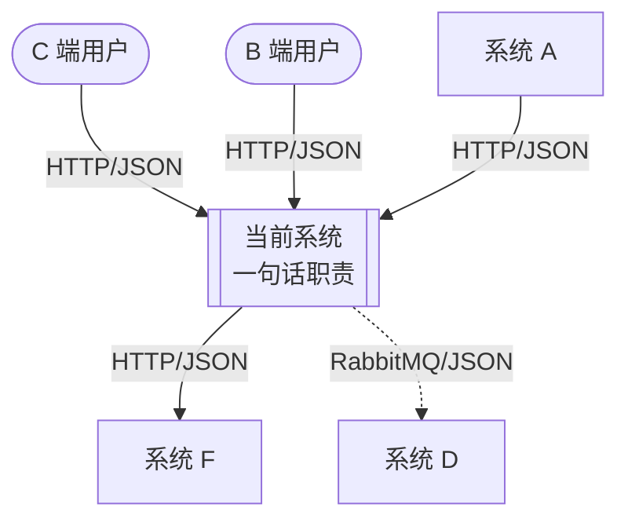
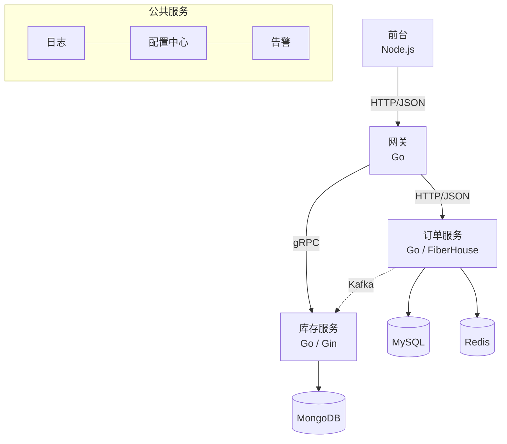

# 系统设计文档

目的是让研发、测试、产品、运维对同一个系统有一致的认识。文档随需求迭代更新，依赖关系变化时必须同步修改两张图。

文件位置：`docs/design/<系统>-architecture.md`。图用 Mermaid 写在 Markdown 中，便于随代码评审与版本管理。

## 1. 收集信息

从代码（`go.mod`、配置文件、客户端初始化代码、路由注册）中查出实际依赖，查不到的再问用户：

- 系统的使用者：C 端用户、B 端用户、内部运营人员等
- 调用本系统的外部系统，以及本系统调用的外部系统；每条依赖的协议（HTTP/JSON、gRPC、消息队列）和同步或异步
- 系统内部的进程或模块、各自的职责与技术栈，以及使用的数据库、缓存、消息队列
- 依赖的公共服务：日志、配置中心、调度、告警等

## 2. 系统上下文图

描述当前系统与其用户以及所依赖系统之间的关系。当前系统画成一个整体，不展开内部。

约定：

- 实线箭头为同步依赖，虚线箭头为异步依赖；箭头方向表示调用方向（A → B 表示 A 调用 B）。
- 每条线标注「协议/数据格式」。
- 每个节点写系统名和一句话职责。

## 3. 系统结构图

描述系统内部的进程、模块与中间件之间的组成关系。

约定：

- 每个模块节点写名称、职责和技术栈（语言 / 框架）；子模块要标出所属的父模块（用 `subgraph`）。
- 数据库、缓存、消息队列用圆柱节点 `[(...)]`，并标出连接方式。
- 用 `subgraph` 区分前台、后台、公共支撑服务等层次。

## 4. 文档其他内容

两张图之后依次写：模块职责表、关键流程（必要时用时序图）、数据存储（链接到 `db-schema-design` 产出的文档）、非功能需求（容量、可用性、监控）、待决问题。重大选型另写 ADR：`docs/adr/NNNN-<标题>.md`。

写完后核对：图中每条依赖在代码或配置中都能找到对应；代码中的每个外部依赖在图中都有体现。
